<!--
  Moonlight Arcade profile
  · assets/*.svg            → python scripts/static_assets.py (edit the PROJECTS list there)
  · output branch graphics  → .github/workflows/arcade.yml, rebuilt twice a day
-->

<p align="center">
  
</p>

<p align="center">
  <a href="https://www.linkedin.com/in/meet-stark/"></a>
  <a href="mailto:starkmeet@gmail.com"></a>
  <a href="https://x.com/StarkMeet"></a>
  <a href="https://stark-game-hub.vercel.app"></a>
  
</p>

## 🌙 Player 1

```python
class MeetStark:
    role     = "AI & Data Science student · Front-end developer"
    school   = "Aivancity School for Technology, Business & Society, Paris (PGE-3)"
    based_in = "Île-de-France, France"
    focus    = ["data engineering", "applied machine learning", "full-stack dashboards"]
    stack    = ["Python", "SQL", "TypeScript", "Next.js", "PostgreSQL", "scikit-learn", "TensorFlow"]
    shipping = "GameHub: 8 daily puzzles with XP, ranks, streaks and leaderboards"
    on_air   = "Founder & host of The Moonlight Mic 🌙🎙️"
    open_to  = "Internships and junior roles in AI, data engineering & analytics"

    def mission(self) -> str:
        return "Turn raw data into products people actually enjoy using."
```

## 🎮 Featured projects

<a href="https://github.com/MeetStark34/GameHub"></a>

<p align="center">
  <a href="https://stark-game-hub.vercel.app"><b>▶ Play GameHub</b></a> &nbsp;·&nbsp; <a href="https://github.com/MeetStark34/GameHub">Source code</a>
</p>

<table>
  <tr>
    <td width="50%" valign="top">
      <a href="https://github.com/MeetStark34/stark-crypto-portfolio"></a>
      <p align="center"><a href="https://stark-crypto-portfolio.vercel.app"><b>Live demo</b></a> · <a href="https://github.com/MeetStark34/stark-crypto-portfolio">Source</a></p>
    </td>
    <td width="50%" valign="top">
      <a href="https://github.com/MeetStark34/youtube-network-dashboard"></a>
      <p align="center"><a href="https://youtube-network-dashboard.vercel.app"><b>Live demo</b></a> · <a href="https://github.com/MeetStark34/youtube-network-dashboard">Source</a></p>
    </td>
  </tr>
  <tr>
    <td width="50%" valign="top">
      <a href="https://github.com/MeetStark34/gamescope-video-game-analytics"></a>
      <p align="center"><a href="https://gamescope-video-game-analytics.vercel.app"><b>Live demo</b></a> · <a href="https://github.com/MeetStark34/gamescope-video-game-analytics">Source</a></p>
    </td>
    <td width="50%" valign="top">
      <a href="https://github.com/MeetStark34/WellpackProject"></a>
      <p align="center"><a href="https://wellpack-project.vercel.app"><b>Live demo</b></a> · <a href="https://github.com/MeetStark34/WellpackProject">Source</a></p>
    </td>
  </tr>
  <tr>
    <td width="50%" valign="top">
      <a href="https://github.com/MeetStark34/AI-Based-Geolocation"></a>
      <p align="center"><a href="https://github.com/MeetStark34/AI-Based-Geolocation"><b>Source</b></a></p>
    </td>
    <td width="50%" valign="top">
      <a href="https://github.com/MeetStark34/Time-Viz"></a>
      <p align="center"><a href="https://time-viz.vercel.app"><b>Live demo</b></a> · <a href="https://github.com/MeetStark34/Time-Viz">Source</a></p>
    </td>
  </tr>
</table>

<details>
<summary><b>More from the arcade</b> (9 more projects)</summary>
<br />

| Project | What it is | Stack |
|:--|:--|:--|
| [AdvPyCourseHomeWork](https://github.com/MeetStark34/AdvPyCourseHomeWork) · [live](https://adv-py-course-home-work.vercel.app) | Advanced Python coursework: OOP projects, data handling and clean-code practice, with a web showcase | Python · TypeScript |
| [MLProj](https://github.com/MeetStark34/MLProj) | Heart disease prediction: data exploration, preprocessing and regression models | Python · Jupyter |
| [segmentation-mstark](https://github.com/MeetStark34/segmentation-mstark) | Customer segmentation with RFM scoring and K-Means: Champions, Potential Loyalists, At-Risk | Python · scikit-learn |
| [AIGriTech-Project](https://github.com/MeetStark34/AIGriTech-Project) | AI-driven analysis of global wine trends: surplus/export vs deficit/import regions | Python |
| [Recommendation-System](https://github.com/MeetStark34/Recommendation-System) | MovieMatcher: a CLI movie recommender with genre and keyword search | Python |
| [MentalWellnessCLI-App](https://github.com/MeetStark34/MentalWellnessCLI-App) | Private, offline mood tracker and journal for the terminal | Python |
| [PyProject-Sem2](https://github.com/MeetStark34/PyProject-Sem2) | Python game suite: Tic-Tac-Toe, Battleship and Wordle with sign-in | Python |
| [Language-Vault](https://github.com/MeetStark34/Language-Vault) | The same CLI tools written in Python, C#, C++ and Java, side by side | Java · C# · C++ · Python |
| [LeetCodes-Problems-Solving](https://github.com/MeetStark34/LeetCodes-Problems-Solving) | Commented LeetCode solutions: arrays, strings, dynamic programming | Python |

</details>

## 🧰 Tech stack

<table>
  <tr>
    <td><b>Languages</b></td>
    <td></td>
  </tr>
  <tr>
    <td><b>Front-end</b></td>
    <td></td>
  </tr>
  <tr>
    <td><b>Data & ML</b></td>
    <td>
      <br />
      
      
      
      
    </td>
  </tr>
  <tr>
    <td><b>Databases</b></td>
    <td></td>
  </tr>
  <tr>
    <td><b>Tools & cloud</b></td>
    <td></td>
  </tr>
</table>

## 🕹️ Arcade mode

<p align="center">
  
</p>

<p align="center">
  
</p>

<p align="center">
  <picture>
    <source media="(prefers-color-scheme: dark)" srcset="https://raw.githubusercontent.com/MeetStark34/MeetStark34/output/snake-dark.svg" />
    <source media="(prefers-color-scheme: light)" srcset="https://raw.githubusercontent.com/MeetStark34/MeetStark34/output/snake-light.svg" />
    
  </picture>
</p>

<p align="center"><sub>Every graphic in this section is rebuilt twice a day by a GitHub Action in this repo.</sub></p>

## 🧭 Journey

<table>
  <tr>
    <td>🎓</td>
    <td><b>Aivancity School for Technology, Business & Society</b> · Paris<br /><sub>Programme Grande École (PGE-3), AI & Data Science: machine learning, advanced analytics, data visualization and real-world data projects</sub></td>
  </tr>
  <tr>
    <td>🎙️</td>
    <td><b>The Moonlight Mic</b> · Founder & Host<br /><sub>Content production, audio editing and mixing, scripting, guest coordination and creative direction</sub></td>
  </tr>
  <tr>
    <td>💼</td>
    <td><b>Saileela Infotech Consultancy</b> · Back-office Executive<br /><sub>Data entry and processing, report preparation, records management and cross-team coordination</sub></td>
  </tr>
  <tr>
    <td>🏫</td>
    <td><b>High school</b> · Computer Science<br /><sub>Programming fundamentals, computer science basics and logical problem solving</sub></td>
  </tr>
</table>

<p align="center">
  <b>Open to internships and junior roles in AI, data engineering and analytics.</b><br />
  <a href="mailto:starkmeet@gmail.com">starkmeet@gmail.com</a> &nbsp;·&nbsp; <a href="https://www.linkedin.com/in/meet-stark/">LinkedIn</a>
</p>


